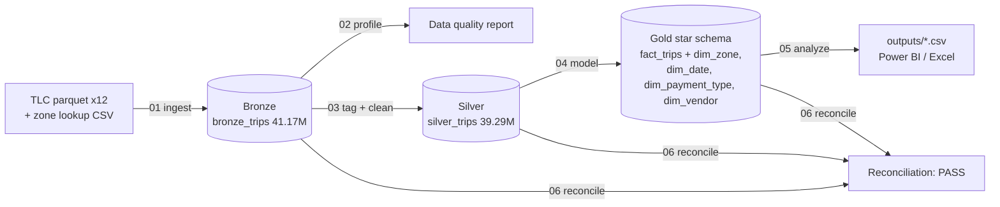
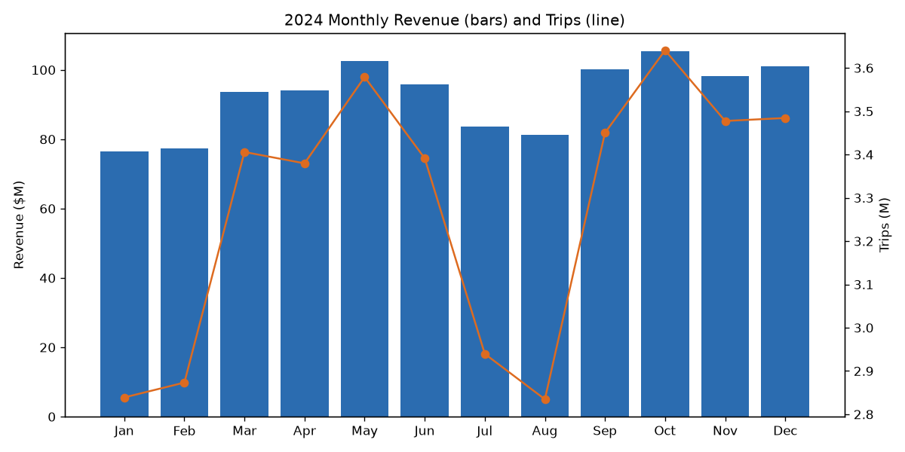
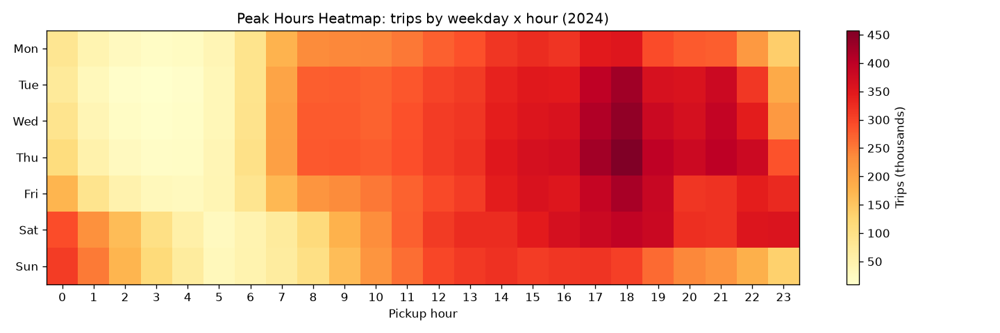
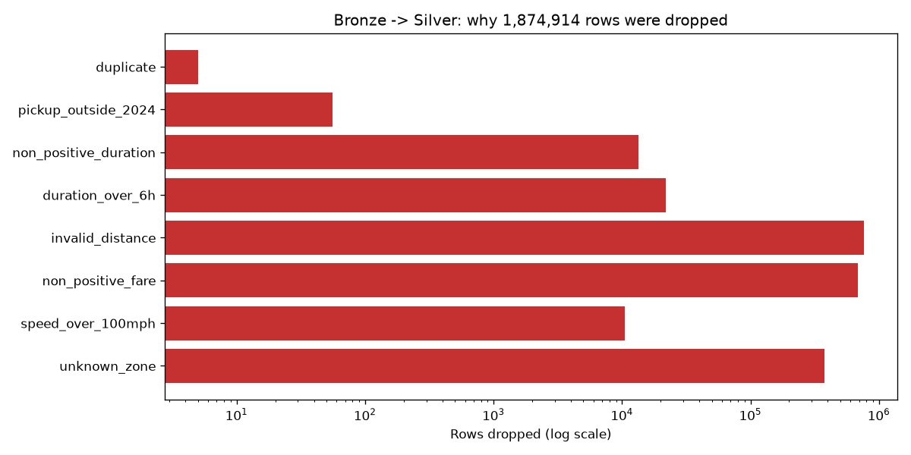
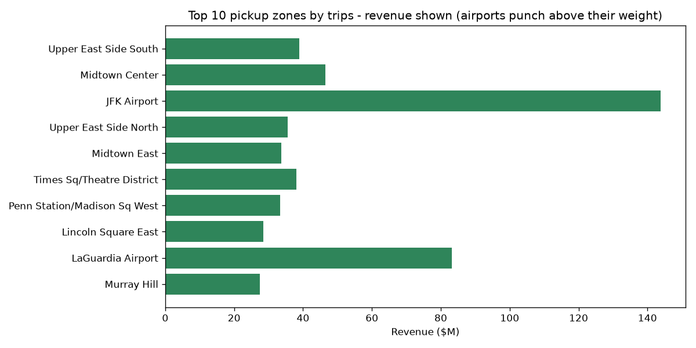
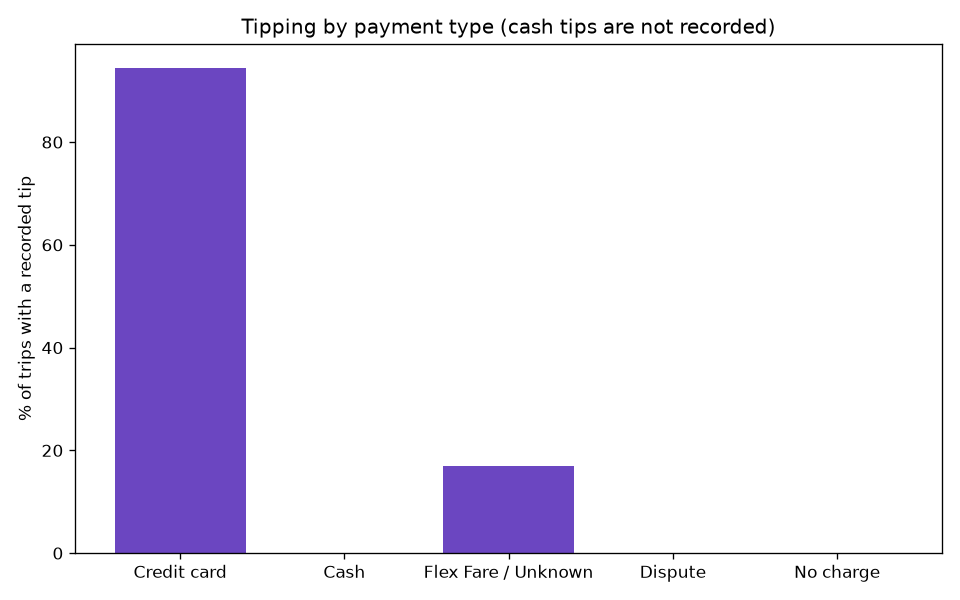

# NYC Taxi SQL Pipeline: 41 Million Trips, End to End in SQL

An end-to-end analytics pipeline built in **pure SQL on DuckDB**: it processes **all 41,169,720 NYC Yellow Taxi trips from 2024**. The data moves through bronze, silver and gold layers into a BI-ready star schema. Every dropped row and every dollar is reconciled back to the source.

## Business problem
A city transport analytics team wants to know where taxi revenue comes from: when demand peaks, which zones and routes matter, how airports and tipping behave, and how fares differ by borough. Before any of that, they need to trust the numbers. So the pipeline profiles data quality first, cleans the data with explicit rules, and proves that bronze = silver + dropped rows, for both row counts and revenue.

## Architecture


| Layer | Script | What it does |
|---|---|---|
| Bronze | `sql/01_bronze_ingest.sql` | Loads the raw parquet files as-is, tags each row with its source file, and counts rows per file |
| Quality | `sql/02_data_quality_checks.sql` | 17 checks (nulls, negative values, impossible durations and speeds, out-of-range dates, duplicates, invalid zones), each with a count and % |
| Silver | `sql/03_silver_clean.sql` | Tags each row with the first rule it fails, keeps the clean rows, and adds derived columns: duration, speed, tip %, hour, weekday |
| Gold | `sql/04_gold_star_schema.sql` | `fact_trips` plus the `dim_zone`, `dim_date`, `dim_payment_type` and `dim_vendor` dimensions |
| Analysis | `sql/05_business_analysis.sql` | CTEs, LAG for month-over-month growth, RANK, NTILE, QUALIFY, FILTER and windowed shares |
| Reconciliation | `sql/06_reconciliation.sql` | Row and revenue tie-out across layers, a reason for every dropped row, FK orphan checks, per-month tie-out |

## Dataset
- **Source:** [NYC Taxi & Limousine Commission (TLC) Trip Record Data](https://www.nyc.gov/site/tlc/about/tlc-trip-record-data.page), Yellow Taxi, January to December 2024, plus `taxi_zone_lookup.csv`.
- **Terms:** public data published by NYC TLC. The raw data is **not** committed to this repo; `scripts/download_data.sh` fetches it.

## Scale (real run)
| Metric | Value |
|---|---|
| Raw rows (bronze) | **41,169,720** |
| Clean rows (silver/gold) | **39,294,806** (95.45%) |
| Raw files | 12 parquet files, **661 MB compressed** (DuckDB database about 10 GB) |
| Revenue processed | $1,145,869,125.72 raw → $1,109,646,437.16 clean |
| End-to-end runtime | **about 56 seconds** on an 8-core, 15 GB RAM Linux box (silver cleaning: 43.7 s) |

## Data quality findings (bronze, 41.17M rows)
| Issue | Rows | % |
|---|---|---|
| Null passenger_count / ratecode (also payment_type 0, "flex fare") | 4,091,232 | 9.94% |
| Zero or negative trip distance | 776,305 | 1.89% |
| Negative fare amount | 731,024 | 1.78% |
| Negative total amount | 609,344 | 1.48% |
| Unknown zone (IDs 264/265) | 425,660 | 1.03% |
| Zero passengers | 401,354 | 0.98% |
| Duration over 6 hours | 22,023 | 0.05% |
| Dropoff at or before pickup | 13,510 | 0.03% |
| Speed over 100 mph | 12,171 | 0.03% |
| Distance over 200 miles | 1,142 | 0.003% |
| Pickup outside 2024 | 56 | <0.001% |
| Exact duplicate trips | 5 | <0.001% |

Rows with a missing passenger count were **kept and flagged** (`passenger_count_missing`) rather than dropped, because they are real paid trips.

## Reconciliation: every row accounted for
| Reason (first rule failed) | Rows | Revenue |
|---|---|---|
| Kept in silver | 39,294,806 | $1,109,646,437.16 |
| Invalid distance (≤0 or >200 mi) | 765,949 | $23,130,855.64 |
| Non-positive fare/total (refunds, voids) | 686,646 | −$15,256,653.98 |
| Unknown zone | 376,258 | $26,659,306.98 |
| Duration over 6 h | 22,001 | $769,447.28 |
| Non-positive duration | 13,510 | $464,685.36 |
| Speed over 100 mph | 10,489 | $452,687.53 |
| Pickup outside 2024 | 56 | $2,274.06 |
| Duplicate | 5 | $85.69 |

**Check:** bronze (41,169,720) − silver (39,294,806) − dropped (1,874,914) = **0 rows, $0.00 difference**. Silver equals gold, and there are **0 orphan foreign keys** across all 5 dimensions. Status: **PASS**. The revenue column sums to the bronze total exactly: negative-value rows are refunds and voids, which is why they offset the others.

## Key insights (2024, clean data)
1. **Airports are 9.93% of trips but 27.21% of revenue.** JFK pickups alone brought in $143.9M at an average of $80.59 per trip.
2. **Revenue is highly concentrated.** The top 10% of pickup zones (27 zones, ranked with NTILE) produced **76.78%** of revenue.
3. **Demand peaks at 6 PM** (2.80M trips), and **Thursday** is the busiest day (6.14M trips). Monday is the quietest (4.88M).
4. **October was the strongest month:** 3.64M trips and $105.4M revenue. Summer slowed down, with July trips −13.32% MoM, before September rebounded +21.71%. The average ticket rose from $26.98 in January to $28.99 in December.
5. **Card riders tip and cash tips go unrecorded.** 76.03% of trips were paid by credit card, and 94.45% of those included a tip, averaging 25.04% of the fare. Recorded cash tips are about 0%.
6. **Manhattan is pricier per mile:** $6.67 per mile against $4.20 in Queens. Manhattan trips are short (2.4 mi average) and slow (9.7 mph).
7. The busiest route was **Upper East Side South → Upper East Side North**, with 275,892 trips.







## How to run
```bash
pip install duckdb matplotlib
./scripts/download_data.sh          # about 661 MB into data/raw/
python scripts/run_pipeline.py      # runs sql/01..06, times each step, exports outputs/*.csv
python scripts/make_charts.py       # images/*.png
```
`outputs/` holds the small CSV exports (data quality, reconciliation and gold aggregates), ready to load into Power BI or Excel.

## Skills demonstrated
SQL at scale (41M rows) · medallion architecture · data profiling and data quality rules · reconciliation and audit trails · dimensional modeling (star schema) · window functions (LAG, RANK, NTILE, SUM OVER) · CTEs, QUALIFY, FILTER, ANTI JOIN · Python orchestration · BI-ready exports · data visualization

## Author
**Vasanth M**, Data Analyst, Bengaluru · [GitHub](https://github.com/Fjiolla-Fjj)
